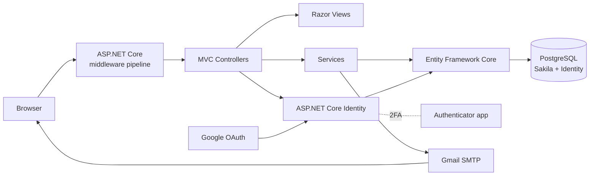

<h1 align="center">SakilaApp</h1>

<p align="center">
  ASP.NET Core MVC web application for managing the classic <strong>Sakila</strong> DVD rental database —
  films, actors, customers, inventory, rentals and stores — secured with ASP.NET Core Identity,
  Google sign-in, email confirmation and two-factor authentication.
</p>

<p align="center">
  
  
  
  
  
  
  
</p>

---

## Features

### Data management
- Full **CRUD** for films, actors, categories, languages, customers, inventory, rentals and stores.
- Management of the **many-to-many** relationships film–actor and film–category.
- **LINQ query showcase** (`Consultas`): filtering, ordering, `Contains`, `Take` and query challenges such as the 10 longest films, drama films, action films sorted by title and customers by last name.

### Security and identity
- Local account registration and login with **ASP.NET Core Identity**.
- **Google sign-in** (OAuth 2.0).
- **Email confirmation** required before the first login.
- **Password recovery**, reset and change via email (Gmail SMTP).
- **Two-factor authentication (2FA)** with an authenticator app such as Microsoft Authenticator, through a custom setup page.
- **Role-based access control** with `Administrator` and `Employee` roles, seeded at startup.
- Separate **dashboards** for users, employees and administrators.

## Architecture



## Access Control

| Area | Who can access |
|---|---|
| `Home/Dashboard` | Any authenticated user |
| `Employee/Dashboard` | Employees and administrators |
| `Admin/Dashboard` | Administrators only |
| `Films`, `Actors`, `Categories`, `FilmCategories`, `Languages`, `Consultas` | Authenticated users |

## Tech Stack

| Layer | Technology |
|---|---|
| Web framework | ASP.NET Core MVC (.NET 10) |
| Data access | Entity Framework Core |
| Database | PostgreSQL (Sakila schema and Identity tables) |
| Authentication | ASP.NET Core Identity, Google OAuth 2.0 |
| MFA | TOTP authenticator apps (Microsoft Authenticator, Google Authenticator) |
| Email | Gmail SMTP (console sender for development) |
| UI | Razor views, Bootstrap |

## Project Structure

```
SakilaApp/
├── Program.cs                      # Service registration and middleware pipeline
├── appsettings.json
├── Areas/Identity/                 # Custom Identity pages (2FA setup)
├── Controllers/                    # CRUD controllers, dashboards, LINQ queries, account
├── Data/
│   ├── SakilaContext.cs            # EF Core context for the Sakila schema
│   ├── ApplicationDbContext.cs     # EF Core context for Identity
│   ├── IdentitySeeder.cs           # Seeds roles and initial users
│   └── MigrationsIdentity/
├── Migrations/                     # EF Core migrations
├── Models/                         # Sakila entities, database views and view models
├── Services/                       # IEmailSender, GmailEmailSender, ConsoleEmailSender
├── Settings/                       # Strongly typed EmailSettings
└── Views/                          # Razor views for every module
```

## Getting Started

### Prerequisites

- [.NET 10 SDK](https://dotnet.microsoft.com/download)
- [PostgreSQL](https://www.postgresql.org/download/) with the [Sakila sample database](https://github.com/jOOQ/sakila) loaded
- A Gmail account with an [app password](https://support.google.com/accounts/answer/185833)
- [Google OAuth credentials](https://console.cloud.google.com/apis/credentials) (Client ID and Client Secret)

### 1. Clone the repository

```bash
git clone https://github.com/EMLarco/SakilaApp.git
cd SakilaApp
```

### 2. Configure secrets

Use **User Secrets** so credentials never end up in the repository:

```bash
dotnet user-secrets init
dotnet user-secrets set "ConnectionStrings:DefaultConnection" "Host=localhost;Port=5432;Database=sakila;Username=postgres;Password=<password>"
dotnet user-secrets set "Authentication:Google:ClientId" "<google-client-id>"
dotnet user-secrets set "Authentication:Google:ClientSecret" "<google-client-secret>"
dotnet user-secrets set "EmailSettings:SmtpServer" "smtp.gmail.com"
dotnet user-secrets set "EmailSettings:SmtpPort" "587"
dotnet user-secrets set "EmailSettings:SenderName" "SakilaApp"
dotnet user-secrets set "EmailSettings:SenderEmail" "<your-email>@gmail.com"
dotnet user-secrets set "EmailSettings:Password" "<gmail-app-password>"
```

In Google Cloud Console, add `https://localhost:<port>/signin-google` as an authorized redirect URI.

### 3. Apply migrations

```bash
dotnet ef database update --context ApplicationDbContext
```

### 4. Run

```bash
dotnet restore
dotnet build
dotnet run
```

Open the URL shown in the terminal.

## Notes

- Local accounts must confirm their email before signing in.
- Sakila data and Identity tables share a single PostgreSQL connection.
- Roles are created automatically at startup by `IdentitySeeder`.

## Author

**Esteban Larco** — Information Technology Engineering student at Universidad de las Fuerzas Armadas ESPE.

[](https://github.com/EMLarco)
[](https://www.linkedin.com/in/esteban-larco-66491843b)
